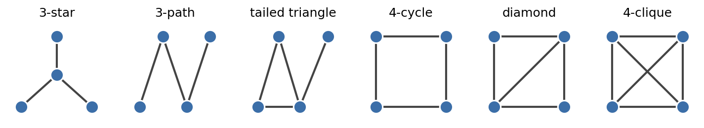

# ldp-subgraph-counting

Counting the six connected 4-node subgraphs (non-induced) under edge local differential privacy (edge-LDP),
with a two-round protocol in the style of Imola et al. (2021).



**Edge-LDP.** Each node (user) knows only its own neighbor list, and there is no trusted server.
Each user adds noise to its own data before sending it, so the server never sees true edges.
A protocol is ε-edge-LDP if, for every user, changing one edge in its neighbor list changes the
probability of any output by at most a factor e^ε. Smaller ε means more privacy and more noise.

## Layout

```
ldpsub/    library code (loading, ground truth, privacy tools, estimators)
tests/     unit tests and sanity checks (pytest)
scripts/   experiment and plotting scripts
data/      SNAP datasets (downloaded, not committed)
results/   experiment outputs and plots (not committed)
docs/      figures for this README
```

## Setup

```bash
python3 -m venv .venv
source .venv/bin/activate
pip install -r requirements.txt
```

## Datasets (SNAP)

- `ca-GrQc` (debugging)
- `ego-Facebook`, `ca-AstroPh`, `email-Enron` (main experiments)

Download all of them into `data/` (run from the repo root):

```bash
python -m scripts.download_data
```

In code: `load_dataset(name, n=None, seed=None)` from `ldpsub.datasets` (`n` samples a random induced subgraph).

## Estimators

In code, from `ldpsub.estimators`. Budgets are passed separately; the caller chooses the split.

- `estimate_3star(G, eps0, eps2, rng)`
- `estimate_<pattern>(G, eps0, eps1, eps2, rng)` for `3path`, `tailed_triangle`, `diamond`, `4clique`
- `estimate_4cycle(G, eps0, eps1, eps2, tau, rng)`

Exact counts: `count_exact(G)` from `ldpsub.exact`.

## Tests

```bash
pytest
```

## References

- J. Imola, T. Murakami, K. Chaudhuri. Locally Differentially Private Analysis of Graph Statistics. USENIX Security 2021.
- A. Pinar, C. Seshadhri, V. Vishal. ESCAPE: Efficiently Counting All 5-Vertex Subgraphs. WWW 2017.
- Guo et al. Quadrilateral (4-cycle) counting under edge-LDP (QuaTR). arXiv:2507.06508, 2025.
- J. Leskovec, A. Krevl. SNAP Datasets: Stanford Large Network Dataset Collection. http://snap.stanford.edu/data, 2014.

## License

MIT, see [LICENSE](LICENSE).
